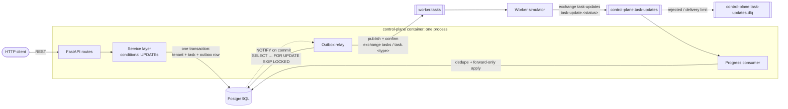
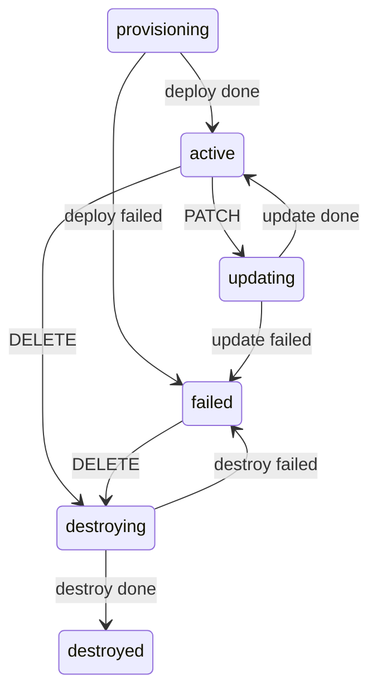

# Tenant Provisioning Control Plane

A control-plane service that records tenants, emits provisioning tasks over a message broker, and
applies the progress that workers report back. It ships with a worker simulator that can inject
failures, delays, duplicate deliveries and reordered deliveries.

**Stack:** Python 3.12 · FastAPI · SQLAlchemy 2 (async) + Alembic · PostgreSQL 17 · RabbitMQ 4
(quorum queues) · Docker Compose · Make.

---

## Quick start

Requirements: **Docker** (with Compose v2) and **make**. Nothing else is needed on the host.

```bash
git clone <this-repo> && cd control_plane
make up      # builds & boots Postgres, RabbitMQ, the control plane and the worker; waits until healthy
make test    # lint + format check + type check + security scan + the full test suite
```

- API: <http://localhost:8000>. Interactive OpenAPI docs are at <http://localhost:8000/docs>.
- RabbitMQ management UI: <http://localhost:15672> (`control_plane` / `control_plane`).
- `make help` lists every command. Use `make down` to stop the stack, and `make clean` to also delete its data.

### Watch a tenant walk its lifecycle

```bash
curl -s -X POST localhost:8000/v1/tenants \
  -H 'content-type: application/json' \
  -d '{"slug": "acme-corp", "name": "Acme Corp"}'
# 201 {"tenant": {"id": "<TENANT_ID>", "status": "provisioning", "version": 1, ...},
#      "task":   {"id": "<TASK_ID>", "type": "deploy", "status": "accepted", ...}}

curl -s localhost:8000/v1/tenants/<TENANT_ID>        # provisioning -> active (within ~4s), version 2
curl -s "localhost:8000/v1/tasks?tenant_id=<TENANT_ID>"  # deploy: accepted -> in_progress -> done
```

No manual steps are involved. The worker picks up the `deploy` task, reports `in_progress` and then `done`, and
the control plane moves the tenant to `active`. Run `make logs` to watch it happen.

---

## Architecture



| Component | Where | What it does |
|---|---|---|
| HTTP API | `app/api/` | Validation, routing, and mapping errors to HTTP. Thin: all logic is in services. |
| Service layer | `app/services/tenant_service.py` | Each mutation is one transaction that writes the tenant, its new task, and the task's **outbox** row. |
| State machine | `app/domain/state_machine.py` | Pure transition rules with no I/O, unit-tested exhaustively. |
| Outbox relay | `app/messaging/outbox_relay.py` | Publishes committed outbox rows to RabbitMQ and marks them published once the broker confirms. |
| Progress consumer | `app/messaging/progress_consumer.py` + `app/services/progress_service.py` | Applies worker updates: idempotent, order-tolerant, poison-safe. |
| Topology | `app/messaging/topology.py` | Exchanges, quorum queues and DLQs. Both processes declare them idempotently. |
| Worker simulator | `worker/` | Consumes tasks and publishes `in_progress`, then `done`/`failed`, with configurable chaos. |

The API, relay and consumer run as three asyncio tasks in **one process**, started and stopped by
the FastAPI lifespan, so the control plane is a single deployable unit (see trade-offs below).

### State machines

Task: `accepted → in_progress → done | failed`. Both `done` and `failed` are terminal.



`version` starts at 1 and is incremented by **every** tenant mutation: API calls and
worker-driven terminal outcomes alike. (`in_progress` changes only the task, not the tenant, so it
does not bump the tenant's version.)

---

## API

All routes are under `/v1`. Request and response bodies are JSON. Timestamps are ISO 8601 UTC with
millisecond precision, e.g. `2026-11-10T06:13:27.309Z`.

| Method | Path | Success | Errors |
|---|---|---|---|
| `POST` | `/v1/tenants` | `201` + `Location`, `{tenant, task}` | `409 tenant_already_exists`, `422` |
| `GET` | `/v1/tenants?status=&limit=&cursor=` | `200` `{items, next_cursor}` | `422` |
| `GET` | `/v1/tenants/{id}` | `200` tenant | `404 tenant_not_found` |
| `PATCH` | `/v1/tenants/{id}` `{name, version}` | `202` `{tenant, task}` | `404`, `409 tenant_update_not_allowed`, `409 tenant_version_conflict`, `422` |
| `DELETE` | `/v1/tenants/{id}` | `202` `{tenant, task}` | `404`, `409 tenant_update_not_allowed` |
| `GET` | `/v1/tenants/{id}/tasks?type=&status=&limit=&cursor=` | `200` `{items, next_cursor}` | `404`, `422` |
| `GET` | `/v1/tasks?tenant_id=&type=&status=&limit=&cursor=` | `200` `{items, next_cursor}` | `422` |
| `GET` | `/v1/tasks/{id}` | `200` task | `404 task_not_found` |
| `GET` | `/healthz` | `200` (checks the DB) | |

Conventions:

- **Status codes:** `201` when a resource is created. `202 Accepted` for `PATCH` and `DELETE`,
  because they start asynchronous work: the response holds the tenant's new state (`updating` /
  `destroying`) and the task that tracks the work.
- **Optimistic locking:** `PATCH` requires the `version` you last read. A stale version gets
  `409 tenant_version_conflict` with `details.current_version`.
- **Delete is a state transition, not a row removal.** The tenant stays readable with status
  `destroyed`, which keeps its slug reserved, as the spec requires.
- **Pagination:** keyset (cursor) pagination, newest first. `limit` is 1-100 (default 20). Pass
  `next_cursor` back as `cursor`; `null` means there are no more pages. Unlike offset pagination,
  it's stable under concurrent inserts.
- **Filtering:** plain query parameters (`status`, `type`, `tenant_id`). Tasks belonging to a tenant
  are also exposed as the sub-resource `/v1/tenants/{id}/tasks`.
- A malformed id in the path (e.g. `/v1/tenants/xyz`) returns `404`, since it can't name a resource.

### Errors

Every error, including validation failures, unknown routes and unexpected exceptions, has the same shape:

```json
{"error": {"code": "tenant_version_conflict",
           "message": "tenant was modified concurrently; re-read it and retry with the current version",
           "details": {"expected_version": 1, "current_version": 2}}}
```

| `code` | HTTP | When |
|---|---|---|
| `tenant_not_found` | 404 | Unknown tenant id |
| `task_not_found` | 404 | Unknown task id |
| `tenant_already_exists` | 409 | Slug taken, including by a `destroyed` tenant |
| `tenant_update_not_allowed` | 409 | `PATCH` outside `active`, or `DELETE` outside `active`/`failed`. `details.status` gives the current status |
| `tenant_version_conflict` | 409 | `PATCH` with a stale `version` |
| `validation_error` | 422 | Bad body or query parameter. `details.errors` lists each problem |
| `invalid_cursor` | 422 | Malformed pagination cursor |
| `not_found` / `method_not_allowed` | 404 / 405 | Unknown route or method (tasks are read-only) |
| `internal_error` | 500 | Anything unexpected. No stack traces are leaked |

The mapping lives in one table: `app/api/errors.py` (`DOMAIN_ERROR_STATUS`).

### More examples

```bash
# Partial update (only from active); send the version you last read
curl -s -X PATCH localhost:8000/v1/tenants/<TENANT_ID> \
  -H 'content-type: application/json' -d '{"name": "Acme Inc", "version": 2}'

# Delete (from active or failed)
curl -s -X DELETE localhost:8000/v1/tenants/<TENANT_ID>

# List and filter
curl -s "localhost:8000/v1/tenants?status=active&limit=10"
curl -s "localhost:8000/v1/tasks?type=deploy&status=failed"
curl -s "localhost:8000/v1/tenants?limit=10&cursor=<next_cursor from previous page>"
```

---

## Messaging

### Wire formats

**Outbound: task event** (exchange `tasks`, routing key `task.<type>`, queue `worker.tasks`).
The task *is* the event: its `id` is the task id, which is also set as the AMQP `message_id`.

```json
{"id": "2fba47a8-…", "type": "deploy", "tenant_id": "e430bdb3-…", "status": "accepted",
 "created_at": "2026-11-10T06:13:27.327Z"}
```

**Inbound: progress update** (exchange `task-updates`, routing key `task-update.<status>`,
queue `control-plane.task-updates`):

```json
{"message_id": "f23b1796-…", "task_id": "2fba47a8-…", "status": "in_progress | done | failed",
 "error": "optional, for failed", "occurred_at": "2026-11-10T06:13:28.600Z"}
```

`message_id` is the **idempotency key**. The worker derives it deterministically as
`uuid5(task_id, "progress:<status>")`, so a worker that crashes and reprocesses a task re-sends the
*same* ids, and the control plane drops them as duplicates.

### Guarantees and how they're achieved

| Requirement | Mechanism |
|---|---|
| Publish **after** the commit, never on rollback | **Transactional outbox.** The service writes the outbox row in the same transaction as the tenant and task, and never talks to the broker. The relay can only see committed rows. The NOTIFY that wakes it is transactional too, so it's delivered on commit and discarded on rollback. |
| Exactly one event per state change | One outbox row per mutation. Delivery is **at-least-once**: a row is marked published only after the broker's publisher confirm, so a crash between confirm and commit causes a re-publish. The task id travels as `message_id` so consumers can dedupe. |
| Consumer is **idempotent** | `processed_messages(message_id PK)`, inserted with `ON CONFLICT DO NOTHING` in the same transaction as the state change. A duplicate is acked and changes nothing. |
| Consumer is **order-tolerant** | Task status only moves strictly forward (`accepted < in_progress < done/failed`). Terminal tasks accept nothing. A late `in_progress` after `done` is recorded as `stale` and acked. A forward *jump* (`accepted → done`, when `in_progress` was lost) is applied, because the terminal outcome is the authoritative fact. |
| Concurrent duplicates | The task row is locked (`SELECT … FOR UPDATE`) before anything else, so two copies processed at the same instant are serialized: one applies and the other sees the duplicate. |
| **Transient** failures retried with backoff | Database errors: retried in-process with exponential backoff (tenacity); if still failing, `nack(requeue)`. Broker outages: `connect_robust` reconnects and restores consumers, startup connects with backoff, and the relay backs off exponentially (capped at 30s) while rows wait safely in the outbox. |
| **Poison** messages don't kill the consumer | An invalid payload or unknown task gets `reject(requeue=False)`, and RabbitMQ dead-letters it to `control-plane.task-updates.dlq`. A message that keeps failing for an unexpected reason is dead-lettered by the quorum queue's `x-delivery-limit` (10) instead of looping forever. Nothing escapes the handler. |

---

## Concurrency

All guards are enforced **by Postgres, atomically**, never by read-then-write in Python:

- **Slug uniqueness:** a `UNIQUE` constraint over all rows, including destroyed ones, since rows are
  never deleted. Concurrent creates with the same slug block on the index; exactly one commits, and
  the others get a unique violation, mapped to `tenant_already_exists`.
- **Optimistic locking and status guards:** a single conditional statement does both:
  `UPDATE tenants SET …, version = version + 1 WHERE id = :id AND version = :v AND status = 'active' RETURNING *`.
  Under concurrency, the second writer blocks on the row lock, re-checks the `WHERE` against the
  committed row, and matches zero rows. Only then does a follow-up read classify *why*
  (404 / version conflict / not allowed). Version is checked before status, so a stale client is
  always told to re-read.
- **At most one open task per tenant** falls out of the status guards: a new task is only created
  by a transition *out of* `active`/`failed`, and the tenant leaves its in-flight status only when
  the task ends. A partial unique index (`tasks(tenant_id) WHERE status IN ('accepted','in_progress')`)
  backs this up as a safety net, so a bug would fail loudly rather than corrupt state.
- Worker-driven tenant transitions are also conditional (`WHERE status = <in-flight status for this task type>`).

`make race` proves this against the running stack: 50 concurrent creates of one slug give exactly
one `201`, and 50 concurrent PATCHes with the same version give exactly one `202`.

```
[PASS] creates: {'409 tenant_already_exists': 49, '201': 1}
[PASS] patches: {'202': 1, '409 tenant_version_conflict': 49}
[PASS] final version: 4
ALL INVARIANTS HELD
```

---

## Reproducing negative scenarios

### By restarting the worker with different settings

Each option is a CLI flag and an env var. In Compose, the env vars are read when the container is recreated.

| Flag | Env var | Default | Effect |
|---|---|---|---|
| `--fail-rate` | `WORKER_FAIL_RATE` | `0` | Probability (0-1) that a task ends `failed` |
| `--min-delay-ms` / `--max-delay-ms` | `WORKER_MIN_DELAY_MS` / `WORKER_MAX_DELAY_MS` | `500` / `2000` | Random delay before each update |
| `--duplicate-rate` | `WORKER_DUPLICATE_RATE` | `0` | Probability that an update is published twice |
| `--reorder` | `WORKER_REORDER` | `false` | Publish the terminal update *before* `in_progress` |
| `--concurrency` | `WORKER_CONCURRENCY` | `4` | Tasks processed in parallel |

```bash
make worker-fail            # = WORKER_FAIL_RATE=1 docker compose up -d --force-recreate worker
#   create a tenant -> it ends `failed`; its task has status `failed` and an `error`
make worker-default         # back to the happy path; now DELETE the failed tenant -> `destroyed`

make worker-chaos           # every update twice + terminal before in_progress
#   tenants still end `active` at version 2; logs show "duplicate" and "stale" updates ignored

# Any combination, e.g. slow and flaky:
WORKER_FAIL_RATE=0.3 WORKER_MIN_DELAY_MS=3000 WORKER_MAX_DELAY_MS=8000 \
  docker compose up -d --force-recreate worker

# Or with CLI flags directly:
docker compose stop worker
docker compose run --rm worker python -m worker --fail-rate=0.5 --duplicate-rate=1 --reorder
```

### By publishing to the broker directly

`scripts/publish_update.sh` publishes through RabbitMQ's own CLI (`rabbitmqadmin`, inside the
`rabbitmq` container):

```bash
TASK=<a task id>

# Out-of-order: a stale in_progress after the task is done -> ignored ("stale" in logs)
scripts/publish_update.sh $TASK in_progress

# Duplicate: the same message_id twice -> processed once, the second copy is logged "duplicate".
# (Use a fresh task, e.g. after `docker compose stop worker`, to see the first copy applied.)
scripts/publish_update.sh $TASK done 11111111-1111-1111-1111-111111111111
scripts/publish_update.sh $TASK done 11111111-1111-1111-1111-111111111111

# Poison: garbage, or an update for a task that doesn't exist -> dead-lettered, consumer keeps going
scripts/publish_update.sh --raw 'garbage'
scripts/publish_update.sh 00000000-0000-0000-0000-000000000000 done
make queues                 # control-plane.task-updates.dlq now holds those messages
```

The equivalent raw command, if you'd rather type it yourself:

```bash
docker compose exec rabbitmq rabbitmqadmin -u control_plane -p control_plane publish message \
  --exchange task-updates --routing-key task-update.done \
  --payload '{"message_id":"<uuid>","task_id":"<task id>","status":"done","occurred_at":"2026-01-01T00:00:00Z"}'
```

You can also publish from, and browse the DLQ in, the management UI at <http://localhost:15672>.

### Infrastructure failures

```bash
docker compose stop rabbitmq      # create tenants: API still answers 201; events wait in the outbox
docker compose start rabbitmq     # relay reconnects and publishes; tenants proceed to active
docker compose restart control-plane   # tenants and tasks survive (Postgres volume)
```

---

## Quality gates and tests

`make test` runs everything inside a container, against the same Postgres and RabbitMQ images, but
isolated in a dedicated database (`control_plane_test`) and vhost (`cp-test`) that are recreated on
every run:

| Gate | Tool |
|---|---|
| Lint | `ruff check` (pyflakes, pycodestyle, bugbear, pylint subset, bandit rules, async pitfalls, …) |
| Format | `ruff format --check` |
| Types | `mypy --strict` |
| Security | `bandit` |
| Tests | `pytest` with branch coverage (~89%) |

`make fmt` auto-formats your working tree. `make lint` runs only the static checks.

The suite has about 130 tests, running in about 6s:

- `tests/unit`: the transition table for every task status pair, tenant outcomes, slug and name validation,
  timestamp format, cursors, wire schemas, deterministic message ids, and worker configuration.
- `tests/integration/test_tenant_api.py`: every endpoint, status code and error code, slug reuse
  after destroy, pagination and filters.
- `tests/integration/test_concurrency.py`: 25-way races, each request on its own DB connection.
  Covers same-slug creates, same-version PATCHes, concurrent DELETEs, PATCH vs DELETE, the same
  progress update delivered concurrently, and `done` vs `failed` racing.
- `tests/integration/test_outbox.py`: rollback publishes nothing, committed rows are published once
  with the right payload and properties, publish failures keep rows for retry, and the relay is woken
  by NOTIFY only on commit.
- `tests/integration/test_progress.py`: duplicates, stale and forward-jump updates, all
  tenant transitions, unknown tasks, the ack/reject/nack decision for every failure class, retry of
  transient DB errors, and poison messages reaching the DLQ through a real broker while the consumer keeps running.
- `tests/e2e/test_lifecycle.py`: the real app (with its lifespan-managed relay and consumer) and the
  real worker over RabbitMQ. Covers create → update → destroy, failure then recovery by restarting the
  worker, convergence under duplicates and reordering, and 20 tenants processed concurrently.

CI (`.github/workflows/ci.yml`) runs `make test`, then boots the stack and runs `make race`.

---

## Design decisions and trade-offs

- **Transactional outbox instead of publishing in the request.** Publishing in the request either
  risks publishing before the commit (so the event describes data that may roll back) or after it
  (so a crash loses the event). The outbox makes the commit the single source of truth, at the cost of
  a little extra latency (about 20ms with NOTIFY) and an extra table. *Alternative considered:*
  CDC/Debezium is more machinery than this scope needs.
- **At-least-once over "exactly once".** Exactly-once delivery doesn't exist, so the system is
  built for at-least-once, with idempotent consumers on both sides: the control plane dedupes on
  `message_id`, and the worker on the task id.
- **The relay holds a DB transaction while it publishes a batch.** That keeps "publish, then mark"
  simple and correct, and `SKIP LOCKED` lets multiple replicas share the work. The cost is that a
  failed publish re-sends the batch's earlier rows, which is acceptable under at-least-once. Batches
  are small (100) and confirms are fast.
- **Forward jumps are allowed** (`accepted → done`). Strict adjacency would wedge a task forever if
  `in_progress` were lost. Monotonic rank keeps correctness, because nothing ever regresses.
- **Stale updates are recorded in `processed_messages` too,** so redeliveries of a stale message are
  cheap no-ops, and the table doubles as an audit log (`outcome`: `applied` or `stale`). It grows without
  bound; in production you'd prune rows older than the broker's maximum redelivery window.
- **API, relay and consumer share one process.** That makes one deployable unit and is simple to
  operate. All three are safe to scale horizontally (SKIP LOCKED, competing consumers, row locks),
  but they can't be scaled *independently*. Splitting them later needs only a different entrypoint.
- **Soft delete only** (`destroyed` is a status). The spec requires destroyed slugs to stay unique,
  and it keeps an audit trail.
- **PATCH applies the new `name` immediately** and moves the tenant to `updating`. The task then
  represents rolling that change out. If the update fails, the tenant goes to `failed` with the new
  name. The alternative (staging a desired spec and applying it on `done`) is more correct for real
  infrastructure, but adds a second copy of every field. Out of scope.
- **Version in the body rather than `If-Match`.** It's simpler for clients and keeps the API JSON-only.
  `409` (not `412`) follows from that, since no precondition header is involved. `DELETE` isn't
  version-checked (the spec only asks for locking on update); it's still race-safe through the status guard.
- **Statuses are text + CHECK constraints rather than Postgres enums.** Adding a status is a
  constraint swap rather than `ALTER TYPE`.
- **RabbitMQ quorum queues.** They're durable and replicated, and they provide `x-delivery-limit`
  for poison protection. Kafka's partition ordering isn't needed: there is at most one open task per tenant, and the
  consumer is order-tolerant anyway.
- **Not done (deliberately):** authentication, multi-tenant authorization, metrics and tracing,
  outbox and dedupe-table pruning, and a DLQ re-drive tool.

## Project layout

```
app/
  api/            routes, request/response schemas, error mapping
  domain/         state machine (pure), domain errors
  db/             SQLAlchemy models, engine/session
  services/       tenant use cases, progress application, pagination
  messaging/      topology, wire schemas, outbox writer, relay, consumer, broker helpers
  main.py         FastAPI app + lifespan (starts relay and consumer)
worker/           worker simulator (python -m worker)
migrations/       Alembic (runs automatically on container start)
scripts/          check.sh (quality gates), race.py, publish_update.sh
tests/            unit / integration / e2e
```

## Configuration

Control plane (`CP_` prefix): `CP_DATABASE_URL`, `CP_AMQP_URL`, `CP_OUTBOX_BATCH_SIZE`,
`CP_OUTBOX_POLL_INTERVAL_S`, `CP_CONSUMER_PREFETCH`, `CP_CONSUMER_MAX_ATTEMPTS`, `CP_LOG_LEVEL`.
See `app/config.py`.

The Compose file has throwaway, local-only default credentials so that `make up` works cold. They aren't
secrets: the services are reachable only on your machine. Override them with env vars or a
git-ignored `.env` (see `.env.example`). No real secrets are stored in the repository.
